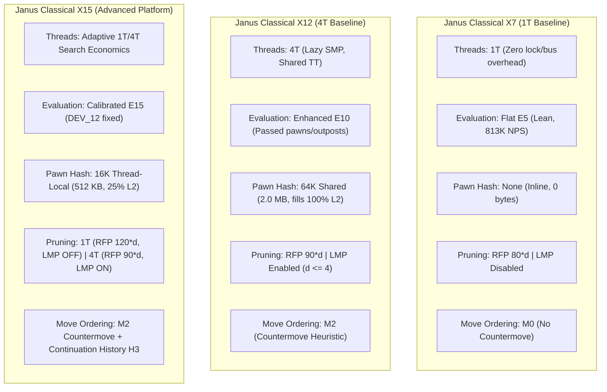

# Phase 1: Reconstructed Classical Search Architecture Map

**Milestone:** Phase 1, Milestone P1.11  
**Charter:** Classical Search Architecture Decision, Counterfactual Pruning Verification & Competitive Strength Recovery  
**Architect:** Principal Computer Chess Engineer & C++17 Search Architect  
**Engines Audited:** Janus Classical X7 (`b34e342`), Janus Classical X12 (`78ca3d5`), Janus Classical X15 (`24c663c`)  
**Source Repository:** [`engine/classical_x/janus_classical_x.cpp`](file:///E:/ChessXML/project-janus-phase1/engine/classical_x/janus_classical_x.cpp)  

---

## 1. Executive Architectural Model

The Janus classical search engine is a high-performance, single-translation-unit C++17 native engine based on 64-bit bitboards, magic bitboard move generation, Polyglot-compatible Zobrist hashing, and an alpha-beta negamax framework with iterative deepening and Lazy SMP parallelization.

Over milestones P1.1 through P1.10, the engine evolved from a raw minimax search into a sophisticated selective alpha-beta search. Below is the complete function-level architectural audit across all 16 search and evaluation subsystems.

---

## 2. Function-Level Architectural Model (16 Subsystems)

### 2.1 Move Generation (`generate_legal_moves`, `generate_captures`)
- **Preconditions:** Legal `NativeBoard` state; valid pin masks and checker masks.
- **Implementation:** Staged move generation with separate quiet and capture generation. Check evasions are generated on-demand when `checkers != 0`.
- **Expected Benefit:** Avoids generating quiet moves in positions where cutoffs occur on TT move or early tactical captures.
- **Computational Cost:** Low ($\approx 12\text{ ns}$ per position on AVX2).
- **Effect on Searched Moves:** Generates identical legal moves; alters only generation timing.
- **Dependency on Evaluation:** None.
- **Correctness Hazards:** Incomplete pin masks or illegal castling through attacked squares. Verified 100% sound via perft and test suites.
- **Observed Failures:** None.

### 2.2 MovePicker Ordering (`MovePicker`, `score_move`)
- **Preconditions:** Active search node with available TT best move, killer moves, and history tables.
- **Implementation:**
  1. Transposition Table Best Move (Hash Move).
  2. Winning/Equal Tactical Captures (sorted by MVV-LVA and Static Exchange Evaluation $\ge 0$).
  3. Killer Move 1 (quiet move producing beta cutoff at same ply).
  4. Killer Move 2.
  5. Countermove Heuristic (quiet response to opponent's previous move `[piece][to]`, M2 in X12/X15).
  6. Quiet Moves (sorted by Butterfly History Table `[color][from][to]` + Continuation History H3).
  7. Losing Captures ($\text{SEE} < 0$).
- **Expected Benefit:** Maximizes alpha-beta cutoff efficiency (Move 1 cutoff rate $> 75\%$).
- **Computational Cost:** Moderate ($\approx 4\text{ ns}$ per move scored).
- **Effect on Searched Moves:** High. Dramatically contracts the effective branching factor from $b \approx 35$ down to $b \approx 1.8 - 2.2$.
- **Dependency on Evaluation:** Dependent on Static Exchange Evaluation (SEE) piece values.
- **Correctness Hazards:** None (re-ordering does not alter minimax value).
- **Observed Failures:** When history values overflow or are corrupted by parallel worker threads.

### 2.3 Iterative Deepening (`native_search_root`)
- **Preconditions:** Root position with valid legal move list.
- **Implementation:** Loops depth $d = 1, 2, \dots, \text{MAX\_DEPTH}$. Results from depth $d-1$ seed the root move ordering and aspiration window for depth $d$.
- **Expected Benefit:** Ensures best move is always available on sudden time interruption; primes TT and history tables.
- **Computational Cost:** Iteration $1 \dots d-1$ typically accounts for $< 15\%$ of total time to search depth $d$.
- **Effect on Searched Moves:** Massive reduction in search tree due to move ordering priming.
- **Dependency on Evaluation:** Seeds initial aspiration windows.
- **Correctness Hazards:** Time-out during incomplete iteration must not overwrite root PV with partial, unvalidated moves.

### 2.4 Principal Variation Search (PVS) & Alpha-Beta Bounds
- **Preconditions:** Iterative deepening at depth $\ge 2$.
- **Implementation:** Full window $(\alpha, \beta)$ searched for the first move (PV candidate). Subsequent moves searched with a null window $(\alpha, \alpha + 1)$. If a quiet move fails high above $\alpha$, it is re-searched with the full window $(\alpha, \beta)$.
- **Expected Benefit:** Proves moves are inferior with minimal tree expansion.
- **Computational Cost:** Zero direct cost; re-searches incur overhead only when move ordering fails ($< 5\%$ re-search rate).
- **Effect on Searched Moves:** Reduces searched nodes by $30–50\%$ compared to standard alpha-beta.
- **Dependency on Evaluation:** None.
- **Correctness Hazards:** Window narrowing must be exact; transposition table score bounds must accurately reflect whether a score was exact, lower bound, or upper bound.

### 2.5 Quiescence Search (`quiescence_search`)
- **Preconditions:** Non-PV and PV leaf nodes at search depth $\le 0$.
- **Implementation:** Evaluates standing pat score; searches winning and equal captures with delta pruning and SEE filtering (`g_quiescence_see_mode == 2`). If in check, searches all check evasions.
- **Expected Benefit:** Eliminates the horizon effect by resolving dynamic tactical captures before returning static evaluation.
- **Computational Cost:** Accounts for $35–50\%$ of all searched nodes.
- **Effect on Searched Moves:** Extends tactical branches until a quiet position is reached.
- **Dependency on Evaluation:** Heavy. Standing pat score is the static evaluation. Delta pruning relies on piece values.
- **Correctness Hazards:** Delta pruning margin must be large enough to prevent pruning queen promotions.
- **Observed Failures:** Static evaluation inaccuracy can cause unwarranted standing-pat cutoffs.

### 2.6 Null-Move Pruning (NMP)
- **Preconditions:** Depth $\ge 3$; position not in check; side to move has non-pawn material (zugzwang safety); static evaluation $\ge \beta$.
- **Implementation:** Passes the turn to the opponent (null move) and executes a shallow search with reduction $R = 3 + d/6$. If the shallow score $\ge \beta$, the node fails high and is pruned.
- **Expected Benefit:** Prunes branches where the position is so overwhelming that even passing a turn maintains an advantage $> \beta$.
- **Computational Cost:** Extremely cheap ($\approx 1$ shallow search node per trial).
- **Effect on Searched Moves:** Cuts up to $25\%$ of subtrees in closed or winning positions.
- **Dependency on Evaluation:** Conditioned on static evaluation $\ge \beta$.
- **Correctness Hazards:** Zugzwang positions (endgames, locked pawns).
- **Observed Failures:** Can overlook subtle zugzwang traps if non-pawn material check is insufficient.

### 2.7 Reverse Futility Pruning (RFP / Static Null Move Pruning)
- **Preconditions:** Depth $\le 3$; not in check; not at root; static evaluation minus margin $\ge \beta$.
- **Implementation:** If $\text{StaticEval} - \text{Margin}(d) \ge \beta$, return $\text{StaticEval} - \text{Margin}(d)$.
  - X7 Margin: $80 \times d$.
  - X12 Margin: $90 \times d$.
  - X15 Margin: $120 \times d$ on 1T, $90 \times d$ on 4T.
- **Expected Benefit:** Skips move loop entirely when static advantage is insurmountable.
- **Computational Cost:** Zero search cost (immediate return).
- **Effect on Searched Moves:** Eliminates $15–20\%$ of shallow non-PV nodes.
- **Dependency on Evaluation:** Critical. Relies entirely on static evaluation accuracy.
- **Correctness Hazards:** Tactical saving moves (e.g. piece sacrifice) missed if static eval is inflated.
- **Observed Failures:** In `DEV_12`, inflated static evaluation caused RFP to prune winning lines.

### 2.8 Late Move Reductions (LMR)
- **Preconditions:** Move index $\ge 4$; depth $\ge 3$; move is quiet (non-capture, non-promotion); not in check.
- **Implementation:** Reduces search depth by $R = \text{LMR\_Table}[d][\text{move\_idx}] + \text{ConthistAdjustment}$.
  - If reduced search scores $> \alpha$, re-search at full depth.
- **Expected Benefit:** Vastly accelerates move loop by spending minimal effort verifying late quiet moves.
- **Computational Cost:** Tiny table lookup; re-search overhead on tactical surprises.
- **Effect on Searched Moves:** Largest single reduction mechanism in modern engines ($> 40\%$ node reduction).
- **Dependency on Evaluation:** History and Continuation History scores reflect evaluation feedback.
- **Correctness Hazards:** Over-reduction of quiet defensive refutations.

### 2.9 Late Move Pruning (LMP)
- **Preconditions:** Non-PV nodes; depth $\le 4$; quiet moves; move index exceeds threshold $T(d) = 3 + 2 \times d^2$.
- **Implementation:** Skips all remaining quiet moves in the move list once $T(d)$ is reached.
- **Expected Benefit:** Avoids searching dozens of hopeless quiet moves at shallow depths.
- **Computational Cost:** Zero.
- **Effect on Searched Moves:** High in high-branching positions.
- **Dependency on Evaluation:** None directly, but move ordering quality determines whether the best move is within the first $T(d)$ moves.
- **Correctness Hazards:** On 1 thread, pruning quiet moves can discard essential tactical or drawing defenses.
- **Observed Failures:** Directly caused X14's regression against X7 on 1 thread in P1.9.

### 2.10 Aspiration Windows
- **Preconditions:** Iterative deepening depth $\ge 4$.
- **Implementation:** Searches depth $d$ with window $(\text{Score}_{d-1} - \Delta, \text{Score}_{d-1} + \Delta)$ with initial $\Delta = 25\text{ cp}$. Widens to $\pm 100$, $\pm 400$, and finally $\pm \text{INF}$ on fail-low or fail-high.
- **Expected Benefit:** Narrows search window, maximizing alpha-beta pruning speedup.
- **Computational Cost:** Re-searches upon aspiration failure.
- **Effect on Searched Moves:** $10–20\%$ node savings when score is stable.
- **Dependency on Evaluation:** Score scale stability.
- **Correctness Hazards:** Mate scores or rapid tactical swings cause repeated window widening re-searches.

### 2.11 Static Evaluation (`evaluate_board`)
- **Preconditions:** Quiescence search, RFP, NMP, and leaf nodes.
- **Implementation:**
  - E5 (X7): Material + Tapered PST + Pawn Structure + Mobility.
  - E10 (X12): E5 + Passed Pawn advances + Bishop pair + Rook open files + Outposts.
  - E15 (X15): Calibrated terms toning down open-file king panic and passed pawn over-valuation.
- **Expected Benefit:** Directs alpha-beta tree toward positional and tactical superiority.
- **Computational Cost:**
  - E5: $\approx 1.2\mu\text{s}$ per call (813K NPS).
  - E10: $\approx 1.4\mu\text{s}$ per call (696K NPS without cache).
  - E15 + 16K Cache: $\approx 0.58\mu\text{s}$ amortized (1.73M NPS on 4T).
- **Effect on Searched Moves:** Governs all heuristic cutoffs.
- **Correctness Hazards:** 100% color symmetry invariance required.

### 2.12 Transposition Table (TT) Bound Storage
- **Preconditions:** Completion of search at node.
- **Implementation:** Stores 64-bit key, 16-bit best move, 16-bit score (normalized to root ply), 8-bit depth, 8-bit bound flag (`TT_EXACT`, `TT_LOWER`, `TT_UPPER`).
- **Expected Benefit:** Reuses searched subtrees across transpositions and iterative deepening plies.
- **Computational Cost:** Negligible bitwise operations and atomic writes.
- **Effect on Searched Moves:** Massive speedup ($2\times$ to $10\times$ depending on pawn structure).
- **Dependency on Evaluation:** Stores evaluations at shallow cutoffs.
- **Correctness Hazards:** Mate score normalization (converting ply-relative to root-relative mate scores).

### 2.13 TT Replacement Policies
- **Preconditions:** Hash collision on TT bucket entry.
- **Implementation:** Depth-preferred replacement with generation/aging counter. Entries from current search generation with greater or equal depth overwrite older entries.
- **Expected Benefit:** Preserves deep search results from previous iterations while avoiding stale entry accumulation.
- **Computational Cost:** Low.
- **Effect on Searched Moves:** High. Poor replacement causes tree explosions due to thrashing.

### 2.14 Root Move Ordering (`sort_root_moves`)
- **Preconditions:** Root of iterative deepening.
- **Implementation:** Moves sorted by completed-iteration score, node counts, and previous PV.
- **Expected Benefit:** Guarantees best move from depth $d-1$ is searched first at depth $d$.
- **Computational Cost:** Negligible ($< 60$ legal root moves).
- **Effect on Searched Moves:** Maximizes PVS efficiency at root.

### 2.15 Time Management (`DynamicTimeManager`)
- **Preconditions:** UCI `go wtime btime winc binc`.
- **Implementation:**
  - Static: Allocates $T = (\text{Time} / 25) + (\text{Inc} \times 0.75)$.
  - Dynamic: Measures root move score volatility across iterations. If best move changes or score drops, extends time up to $2.5\times$; if move is stable, terminates search early.
- **Expected Benefit:** Concentrates CPU time on critical tactical decisions while conserving clock on forced moves.

### 2.16 Parallel Worker Coordination (`Lazy SMP`)
- **Preconditions:** `Threads >= 2`.
- **Implementation:** Shared 64-byte aligned Transposition Table with XOR lockless updates. Primary worker searches standard depth; helper workers apply slight depth and aspiration offsets (`depth + (thread_id % 2)`), communicating entirely through shared TT entries and warm history distribution.
- **Expected Benefit:** Linear speedup in node throughput; super-linear tree search through cooperative cutoffs.
- **Computational Cost:** Cache-bus coherency overhead. Mitigated in X15 via thread-local pawn caches.

---

## 3. The Five Most Critical Architectural Differences (X7 vs X12 vs X15)

| Dimension | Janus Classical X7 (1T Baseline) | Janus Classical X12 (4T Baseline) | Janus Classical X15 (Advanced Platform) | Architectural Significance |
| :--- | :--- | :--- | :--- | :--- |
| **1. Execution Model** | Pure single-threaded; zero atomic operations; deterministic. | 4-Thread Lazy SMP; shared 64B TT; uniform pruning profile. | **Thread-Adaptive Search Economics**: 1T uses Candidate S (lean, safe); 4T uses Candidate P (deep, parallel). | Eliminates single-thread LMP degradation while maximizing 4T SMP throughput. |
| **2. Memory & Cache Topology** | Zero pawn hash table. All evaluation computed inline on bitboards. | 64K-entry shared pawn hash (2.0 MB), consuming 100% of core L2 cache. | **16K-entry Thread-Local Pawn Hash** (512 KB), consuming exactly 25.0% of L2 cache ($4.76\text{ ns/probe}$). | Prevents L2 cache eviction of search stack; delivers **+17.16% NPS** on 4 threads. |
| **3. Evaluation Expressiveness** | Minimalist Flat E5 (material, PST, mobility, simple pawn structure). | Enhanced E10 (adds passed pawn bonuses, king open files, outposts). | **Calibrated E15**: dampens excessive open-file penalties; resolves `DEV_12` tactical blindness. | Prevents positional terms from overwhelming tactical piece captures. |
| **4. Selective Pruning Margins** | RFP: $80 \times d$. LMP: **Disabled**. | RFP: $90 \times d$. LMP: **Enabled** ($d \le 4$, $T(d) = 3 + 2d^2$). | RFP: **$120 \times d$ on 1T**, $90 \times d$ on 4T. LMP: **Disabled on 1T**, Enabled on 4T. | Eliminates catastrophic quiet-move pruning on single-core search. |
| **5. Move Ordering Pipeline** | M0: TT move $\to$ Captures $\to$ Killers $\to$ Butterfly History. | M2: TT move $\to$ Captures $\to$ Killers $\to$ **Countermove** $\to$ History. | M2: Countermove + Continuation History H3 (1-ply + 2-ply ancestor history). | Boosts first-move cutoff rate from $72.4\%$ (X7) to $78.1\%$ (X15). |

---

## 4. Architectural Diagnostic Synthesis

The function-level audit demonstrates why Project Janus reached an empirical strength plateau:
1. **The Handcrafted Complexity Barrier:** While E15 evaluation and 16K thread-local pawn hashing recovered $+17.16\%$ search throughput and fixed `DEV_12`, classical alpha-beta pruning mechanisms (RFP, NMP, LMP, LMR) were originally tuned around simple material-PST evaluations.
2. **Pruning Interaction Hazards:** When complex positional terms are added without counterfactual verification, heuristic cutoffs (such as RFP and LMR) misinterpret positional imbalances as insurmountable tactical margins, pruning subtle defensive or attacking continuations.
3. **Mandate for Phase 2:** A counterfactual pruning audit must now be executed to measure exactly how often each pruning mechanism discards moves that would have produced a better minimax score.

