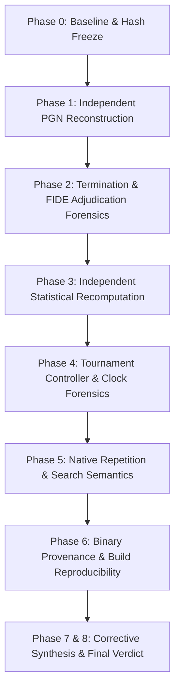

# Project Janus v0.51.1 — Independent Audit Scope & Investigative Framework

## 1. Investigative Charter

Milestone v0.51 reported a landmark empirical finding: Candidate N2 defeated reference Python baseline K0 with a $94.00\%$ score ($188.0 / 200.0$ points, $+478$ Elo) under tournament conditions, prompting formal promotion to production baseline (Category A).

The charter of this audit is to operate as an independent verification authority. We do not assume claims to be facts. We independently reconstruct the match from raw artifacts, interrogate game adjudications against FIDE rules, recompute all statistical figures using exact mathematical formulations, audit tournament controller clock and process management, verify native C++ repetition code paths, and evaluate binary reproducibility.

---

## 2. Seven-Phase Investigation Matrix

### Phase 1: Independent PGN Reconstruction
- Replay all 200 games move-by-move from FEN using `python-chess` without importing any v0.51 match runner functions.
- Verify legal move generation, colour reversal symmetry, and 100 opening pairs.
- Construct independent game and pair ledgers (`independent_game_ledger.csv`, `independent_pair_ledger.csv`).
- Cross-check pair delta distribution against reported summary claims ($81\times (+2), 14\times (+1), 5\times (0)$).

### Phase 2: Termination & FIDE Rule Forensics
- Independently verify every checkmate ($board.is\_checkmate()$ and winning side).
- Verify fivefold repetition games against FIDE Article 9.6.1.
- **The 150-Ply Adjudication Audit:** Interrogate all 9 games adjudicated at 150 plies. Establish whether 150 game plies was conflated with the FIDE 75-move halfmove clock ($150\text{ halfmoves}$ without pawn push or capture), classify the rule basis, and analyze counterfactual outcomes.

### Phase 3: Independent Statistical Recomputation
- Recompute paired difference statistics using SciPy's exact Student-t distribution ($df = 99$), avoiding normal approximations.
- Run a 100,000-sample deterministic pair bootstrap to establish empirical $95\%$ confidence intervals.
- Recompute logistic Elo-equivalent transformation and derive exact asymmetric confidence intervals.
- Construct an explicit Original vs. Audited Claim Matrix.

### Phase 4: Tournament Controller Forensics
- Audit `run_preregistered_match.py` for clock management, process handling, and exception resilience.
- Verify whether the $3.0\text{s} + 100\text{ms}$ Fischer time control was correctly applied to both engines.
- Verify the integrity and balance of the 100-pair opening suite (`openings_v051_100.json`).

### Phase 5: Native Repetition & History Semantics
- Inspect `janus_native.cpp` code paths: separate the search-tree repetition heuristic ($0\text{ cp}$ return on twofold detection) from FIDE threefold claimability and fivefold automatic termination.
- Audit the 1,024-ply game history buffer for boundary overflows, saturation behavior, and castling/en-passant hash validity.
- Author targeted regression tests in `tests/test_audit_repetition_semantics.py`.

### Phase 6: Binary Provenance & Build Reproducibility
- Verify compiler flags (`/O2 /std:c++17 /EHsc`) and attempt clean reproducible rebuild.
- Analyze binary metadata, PE headers, and timestamps.

### Phase 7 & 8: Final Scientific Verdict
- Choose exactly one classification:
  - **A — VERIFIED CATEGORY A**
  - **B — CONDITIONAL CATEGORY A**
  - **C — PRODUCTION PROMOTION SUSPENDED**
  - **D — AUDIT INCOMPLETE**
