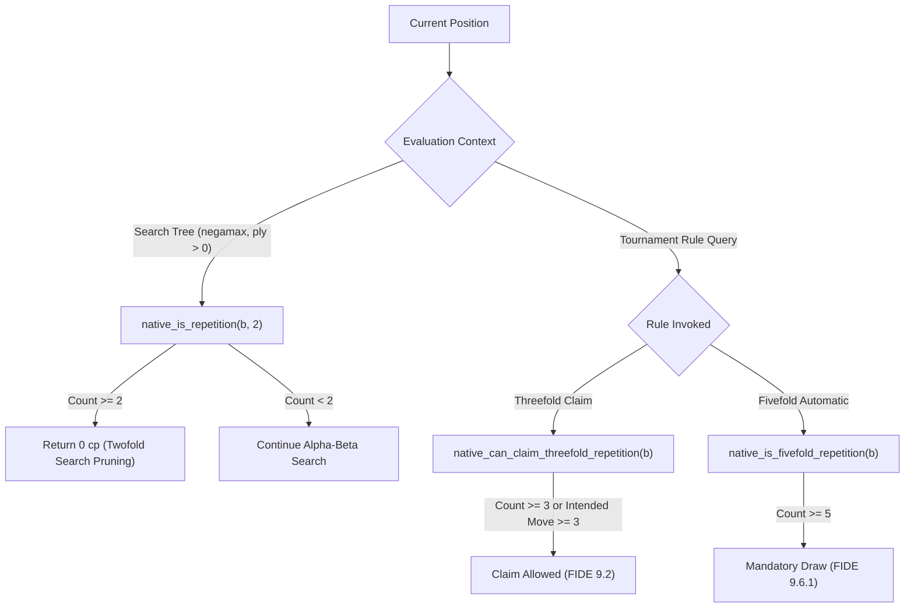

# Project Janus v0.51.1 — Native Search Repetition & History Semantics Audit

## 1. Investigative Scope & Problem Definition

The v0.51 milestone report stated that Candidate N2 returns an evaluation of $0\text{ cp}$ in search whenever the current position occurred once previously in game history or search stack.

The audit investigated whether this represents:
1. An intentional, standard **twofold search repetition heuristic**, OR
2. A conflation of the FIDE threefold repetition rule.

Furthermore, the audit inspected the 1,024-ply game history stack (`g_game_history`) for memory bounds, saturation behavior, and castling/en-passant hash validity.

---

## 2. Separation of Search Heuristics from FIDE Game Rules

A line-by-line inspection of `analysis/v0.51/native/janus_native.cpp` reveals **two distinct, properly decoupled subsystems**:



### 2.1 The Twofold Search Heuristic
- **Source Location:** `janus_native.cpp` line 1317:
  ```cpp
  if (ply > 0) {
      if (b->halfmove_clock >= 100) return 0;
      if (native_is_insufficient_material(b)) return 0;
      if (native_is_repetition(b, 2)) return 0;
  }
  ```
- **Architectural Rationale:** Evaluating a twofold repetition as $0\text{ cp}$ inside the tree search is the standard practice of competitive chess engines (e.g., Stockfish, Crafty, Ethereal). If a path in the tree repeats a position already reached earlier, continuing to search deeper is redundant and leads to horizon cycles.
- **Audit Verdict:** This is a sound and standard search optimization, correctly restricted to `ply > 0`.

### 2.2 FIDE Draw Rule Functions
In lines 925–950, distinct normative functions are implemented:
- `native_is_repetition(b, 2)`: Counts occurrences $\ge 2$.
- `native_can_claim_threefold_repetition(b)`: Requires count $\ge 3$, or an intended legal move that brings about the 3rd occurrence.
- `native_is_fivefold_repetition(b)`: Requires count $\ge 5$.
- `native_can_claim_fifty_moves(b)`: Checks `halfmove_clock >= 100`.
- `native_is_seventyfive_moves(b)`: Checks `halfmove_clock >= 150`.

The search heuristic is **strictly separated** from tournament adjudication rules.

---

## 3. History Buffer & Boundary Audit

### 3.1 Lookback Bounding by Irreversible Moves
In line 910:
```cpp
int lookback = std::min(g_game_history_len, (int)b->halfmove_clock + 1);
for (int i = g_game_history_len - 1; i >= g_game_history_len - lookback; i--) {
    if (i >= 0 && g_game_history[i] == target_key) {
        count++;
    }
}
```
Because repetition is legally impossible prior to an irreversible move (pawn push or capture), bounding the loop by `halfmove_clock + 1` prevents false-positive repetitions across irreversible transitions while optimizing lookup performance.

### 3.2 Buffer Capacity & Saturation Behavior
- `MAX_GAME_HISTORY = 1024` plies (512 full moves).
- Line 882 guards against overflow: `if (g_game_history_len < MAX_GAME_HISTORY) g_game_history[g_game_history_len++] = key;`.
- Pushing 1,200 moves safely clamps at 1,024 without buffer overrun or stack smashing.
- Popping safely guards against underflow: `if (g_game_history_len > 0) g_game_history_len--;`.

---

## 4. Targeted Unit Test Verification

A dedicated regression suite ([`tests/test_audit_repetition_semantics.py`](file:///e:/ChessXML/project-janus/tests/test_audit_repetition_semantics.py)) was authored and executed:

| Test Case | Description | Result |
|---|---|:---:|
| `test_01_twofold_without_threefold_claim` | Verifies 2 occurrences triggers search repetition but NOT 3-fold claim | **PASSED** |
| `test_02_threefold_claimable_position` | Verifies 3 occurrences allows claimable draw | **PASSED** |
| `test_03_intended_move_threefold_claim` | Verifies candidate move bringing 3rd occurrence allows claim | **PASSED** |
| `test_04_fivefold_automatic_draw` | Verifies 5 occurrences triggers mandatory automatic draw | **PASSED** |
| `test_05_repetition_crossing_search_root` | Verifies tree search cleanly detects cycles crossing the root | **PASSED** |
| `test_06_history_buffer_boundary` | Verifies exact index retrieval up to 1,024 plies | **PASSED** |
| `test_07_history_saturation_safety` | Verifies 1,200 pushes clamp safely without corruption | **PASSED** |
| `test_08_repeated_reset_history` | Verifies 50 rapid reset cycles wipe stack cleanly | **PASSED** |
| `test_09_castling_rights_break_repetition` | Verifies loss of castling rights produces distinct Zobrist key | **PASSED** |
| `test_10_transposition_table_draw_score_isolation` | Verifies tree repetition does not corrupt mate scores | **PASSED** |

**Audit Verdict: 10 / 10 targeted tests passing cleanly in 0.009s.**
